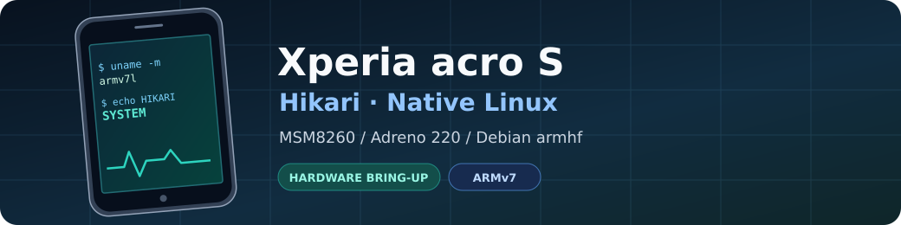
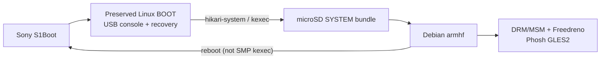

<p align="center">
  
</p>

<p align="center">
  <a href="https://github.com/BlackF1re/acro-linux/actions/workflows/hikari-kernel-audit.yml"></a>
  
  
  
</p>

# Xperia acro S · Native Linux

A **mainline-oriented Linux port** for the **Sony Xperia acro S LT26w** (`Hikari`): Qualcomm **MSM8260**, dual-core **Scorpion**, **Adreno 220**, Debian **armhf**, and hardware-accelerated **Phosh**. Android userspace and libhybris are not used for the native graphics path.

> [!IMPORTANT]
> **Hardware bring-up, not a daily-driver phone.** Boot, display, touch, GPU and several peripherals have passed physical tests. Telephony, audio, cameras and full suspend/recovery reliability have **not**. The pinned source, running SYSTEM image and experimental test bundles are not interchangeable evidence.

## Hardware status

| Area | On-device evidence | Limits |
|---|---|---|
| 🟢 **Boot & storage** | Preserved BOOT → microSD SYSTEM via kexec; working Debian filesystem | Native internal-eMMC SYSTEM use not accepted |
| 🟢 **CPU & memory** | Two cores online; RAM stress test; microSD reads/writes | CPU1 hotplug return and full DVFS pending |
| 🟢 **Display & touch** | 720×1280 native MDP4/DSI scanout, backlight, multitouch | Some resume/handoff paths still regress |
| 🟢 **Graphics** | Adreno 220 + DRM/MSM + Freedreno; real GLES2 Phosh | Full stability/conformance not established |
| 🟢 **USB** | ACM console, NCM networking, powered USB OTG + HID | Suspend/endurance not fully qualified |
| 🟡 **Wi-Fi / Bluetooth** | Wi-Fi traffic/reconnect; Bluetooth discovery | Later Wi-Fi SDIO failure; pairing/audio untested |
| 🟡 **Charging & sensors** | USB charging; gauge readings; motion/proximity; LEDs | Calibration, protection and full cycles pending |
| 🟡 **Sleep / power** | Bounded CPU/RPM deep-collapse and wake tests, including physical screen/touch recovery | All-device resume, wake sources, power draw unverified |
| ⚪ **Phone / media** | Hardware/source investigations | Calls, mobile data, native audio, cameras, HDMI not accepted |

**Legend:** 🟢 physically demonstrated function · 🟡 partial acceptance · ⚪ not accepted. This is **not** a complete list of device features.

> [!NOTE]
> Evidence belongs to a **specific build and test**. The 2026-10-04 connected SYSTEM lacked a cpufreq policy even though newer CPU DVFS source existed. Later 2026-10-09 sleep tests succeeded under constrained conditions, **not** as full-system release validation. See [current status](docs/STATUS.md), [power evidence](docs/POWER.md) and the [hardware inventory](docs/HARDWARE.md).

## Boot design



> [!WARNING]
> **Do not rewrite the known-good BOOT or kexec from SMP SYSTEM.** Test kernels belong in separate microSD SYSTEM bundles. Keep rollback material intact; see [boot architecture](docs/BOOT.md) and [recovery gates](docs/RECOVERY.md).

## Build & verify

```sh
# Create a new source checkout; the materializer refuses to reset an existing tree.
scripts/materialize-hikari-kernel.sh /path/to/new/linux-hikari

# Compile from the reconstructed source.
KERNEL_SRC=/path/to/new/linux-hikari scripts/build-hikari-debian-kernel.sh

# Repository tests (not physical hardware acceptance).
python3 -m unittest discover -s tests
```

**[Full build / packaging / transfer →](docs/BUILD.md)** · **[Physical test checklist →](docs/TESTING.md)**

> [!CAUTION]
> The bring-up SSH configuration deliberately permits **root login with an empty password**. Do **not** expose that system to untrusted networks. Remove this policy before normal deployment; details in [Debian setup](docs/DEBIAN.md).

## Documentation

| I want to… | Read |
|---|---|
| Check what **actually works** | [Status](docs/STATUS.md) · [Hardware evidence](docs/HARDWARE.md) |
| Build / deploy without touching BOOT | [Build](docs/BUILD.md) · [Boot](docs/BOOT.md) · [Recovery](docs/RECOVERY.md) |
| Understand the GPU/display path | [Display](docs/DISPLAY.md) · [Performance](docs/PERFORMANCE.md) |
| Review sleep / charging | [Power](docs/POWER.md) · [Charging](docs/CHARGING.md) |
| Work on connectivity and media | [USB](docs/USB.md) · [FM](docs/FM.md) · [Audio](docs/AUDIO.md) |
| Audit source / hardware claims | [Sources](docs/SOURCES.md) · [Patch audit](docs/FUNCTIONAL-PATCH-AUDIT.md) |
| Contribute or run acceptance tests | [Contributing](CONTRIBUTING.md) · [Testing](docs/TESTING.md) |

<details>
<summary><strong>Project layout & engineering approach</strong></summary>

| Path | Purpose |
|---|---|
| [`kernel/`](kernel/) | Pinned Linux base, consolidated subsystem patches, DTS, kernel configs |
| [`debian/`](debian/), [`distro/`](distro/), [`ui/`](ui/) | Userspace configuration, Mesa fixes, mobile UI |
| [`initramfs/`](initramfs/) | Independent BOOT and SYSTEM stages |
| [`scripts/`](scripts/), [`tools/`](tools/), [`tests/`](tests/) | Reconstruction, build, transfer, diagnostics and checks |
| [`status/`](status/), [`docs/`](docs/) | Machine-readable acceptance and maintained explanations |
| [`research/`](research/) | Historical experiments and device evidence; not automatic build inputs |

Maintained patches are grouped by subsystem for reproducible reconstruction. Future upstream submissions will need smaller logical series. The original Sony/Android BSP is a **hardware reference**, not the runtime base.

</details>

<details>
<summary><strong>License & development</strong></summary>

[GPL-2.0-or-later project license](LICENSE) · [Third-party licensing](LICENSING.md) · [Security](SECURITY.md) · [Contributing](CONTRIBUTING.md) · [Code of conduct](CODE_OF_CONDUCT.md)

Third-party code/firmware retain their own licenses. Private firmware, credentials, calibration, raw partition backups and unsanitized logs must never enter Git.

Git history was reorganized and signed on 2026-10-05; [details](docs/HISTORY-SIGNING.md). Existing local clones may need careful reconciliation.

</details>
