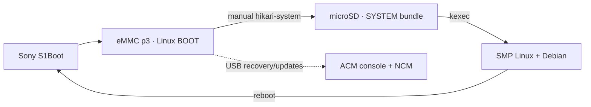

# Boot architecture

## Two separate environments

| Stage | Purpose |
|---|---|
| **BOOT** | Preserved UP kernel / initramfs: recovery shell, USB transfer, kernel selection |
| **SYSTEM** | Modern SMP Linux, matching modules, Debian rootfs and Phosh |
| **Restart** | Normal reboot through S1Boot back to BOOT — **not** SMP-to-BOOT kexec |

> [!NOTE]
> BOOT deliberately **stops at its prompt**; it does not launch SYSTEM automatically. The banners end in `BOOT` or `SYSTEM` so the active stage is identifiable.

## BOOT commands

| Command | Action |
|---|---|
| `hikari-system` | Mount `HIKARI_ROOT`, verify `/boot/hikari-next/SHA256SUMS` and kexec the selected kernel/DTB/initramfs |
| `hikari-receive-system` | Stage a matching kernel/modules update over USB NCM; XMODEM fallback |
| `hikari-receive-rootfs SHA256` | Verify and unpack Debian archive over NCM using GNU tar |
| `reboot` / `poweroff` | Leave BOOT without launching SYSTEM |

## Fixed recovery boundary

> [!WARNING]
> **Do not rewrite eMMC p3 during normal development.** SYSTEM experiments belong on microSD. The BOOT kernel and initramfs are the recovery anchor, not a duplicate Debian system.

- Verified p3: **20 MiB Sony ELF boot partition**; current ELF segment addresses include kernel `0x40208000`, ramdisk `0x41800000`, preserved RPM payload `0x00020000`.
- Do not target p1, p2, p5–p11, eMMC boot0/boot1, RPMB or unknown partitions.
- BOOT/SYSTEM have separate upgrade and recovery paths; preserve existing pstore evidence before reset.
- GNU tar is used for rootfs because BusyBox tar fails on valid Debian usr-merge links (e.g. `/sbin/init -> ../lib/systemd/systemd`).

[Partition evidence](PARTITIONS.md) · [Recovery rules](RECOVERY.md) · [USB transport](USB.md)
